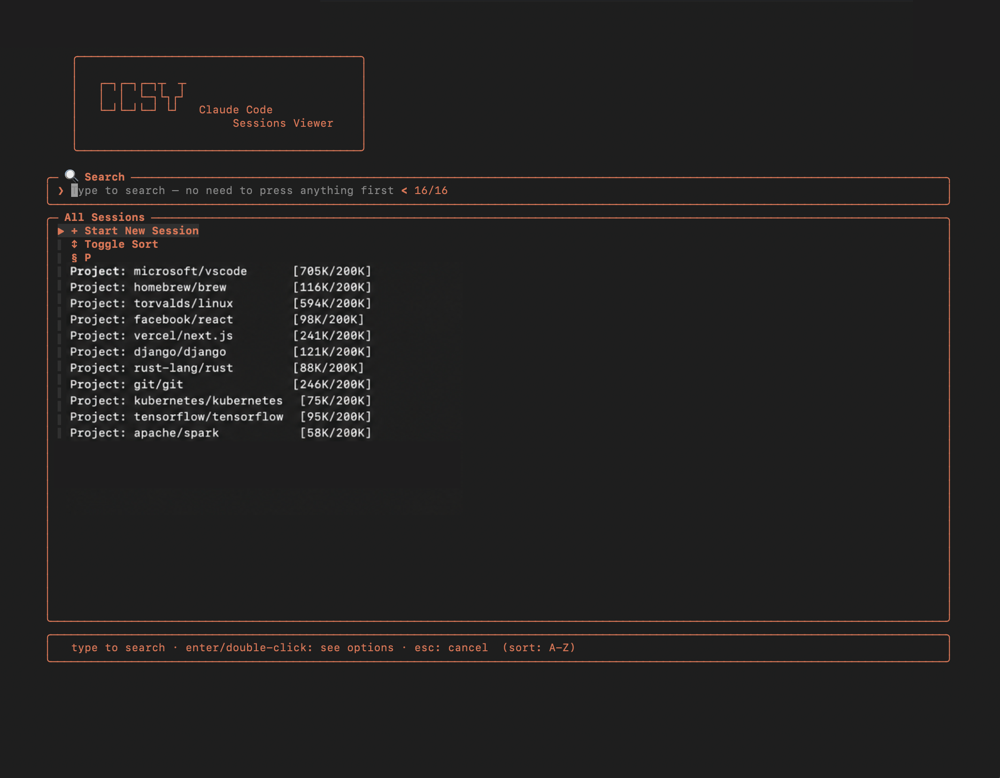
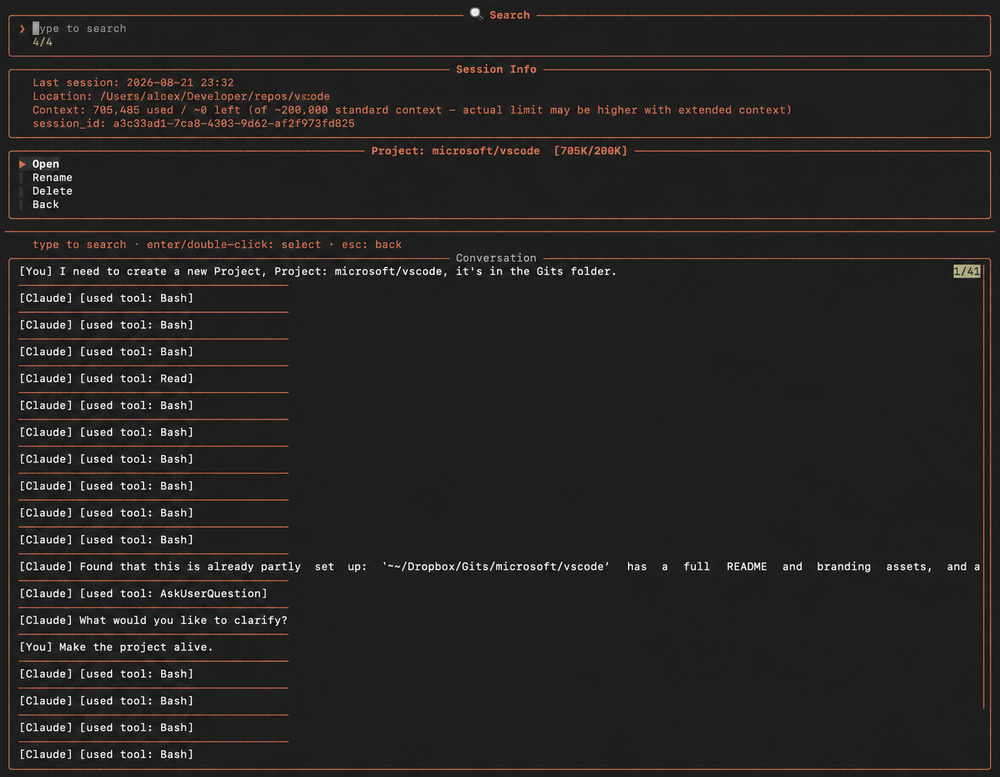

# Claude Code Sessions Viewer

```
╭──────────────────────────────────────────╮
│                                          │
│   ┌─┐┌─┐┌─┐┬  ┬                          │
│   │  │  └─┐└┐┌┘                          │
│   └─┘└─┘└─┘ └┘   Claude Code             │
│                       Sessions Viewer    │
│                                          │
╰──────────────────────────────────────────╯
```

[](https://www.python.org/)
[](https://opensource.org/licenses/MIT)
[](#requirements)
[](https://github.com/maxhayim/claude-code-sessions-viewer/releases/tag/v3.0.0)

> **Unofficial, community-built project. Not affiliated with, endorsed by,
> or sponsored by Anthropic.** "[Claude Code](https://github.com/anthropics/claude-code)" refers to Anthropic's product;
> this tool simply reads its local session files and runs your own `claude`
> binary.

> **Status: v3.0.0.** Local session browsing is verified end-to-end against
> real `~/.claude/projects/` data, including the Homebrew install path. Live
> Sessions and compact mode are verified on this machine and over a real
> SSH session. Cloud Sessions' "Send follow-up" action and attaching to an
> *interactive* (not backgrounded) session are unverified — see
> [Known Limitations](#known-limitations). The Cardputer Zero itself has
> not been tested by the maintainer directly; a device owner's test is the
> next real-world check.

**Claude Code Sessions Viewer** lists — and lets you visually browse — every 
[Claude Code](https://github.com/anthropics/claude-code) session you've ever started, across every project directory and
git worktree on your machine, all in one flat, alphabetically-sorted,
dictionary-style list — no digging through per-project menus. Claude Code's
own picker only shows sessions from your current directory unless you know
to widen it, and even widened it renders as a small fixed-height box with
no real preview. This project adds two things on top:

- **`/list-sessions`** — a plain-text listing you run inside a Claude Code
  session, grouped by project, most recent first.
- **`bin/claude-sessions`** — a standalone, `fzf`-powered visual browser:
  fuzzy search, arrow-key navigation, per-row context-usage indicators, and
  an Open/Rename/Delete/Back menu (showing that session's info) for every
  session, reached by picking it. It also covers **Live Sessions** (other
  `claude` processes already running on this machine) and **Cloud
  Sessions** (Anthropic-hosted, via `claude --cloud`), and switches to a
  **compact layout** on narrow terminals — see
  [Remote, Cloud, and Compact Use](#remote-cloud-and-compact-use).

## Screenshots

**The main list** — every session across every project, one flat
alphabetical list:



**Picking a session** opens the Open/Rename/Delete/Back menu, showing that
session's info and a conversation preview:



## Features

- Scans every project directory Claude Code has ever recorded a session in,
  not just the current one, and shows every session in **one flat,
  alphabetical list** — grouped into dictionary-style letter sections
  (`§ A`, `§ B`, ...) rather than nested per-project submenus
- Shows each session by its real name — its Claude Code `/rename` title if
  it has one, its first-message preview otherwise
- Resolves each project's real identity from its **git remote**, not its
  local folder name — so a repo checked out into a generically-named
  folder (e.g. everything living under a local `Repo/` directory) still
  shows its actual GitHub repo name, and a session run outside any git repo
  gets its own top-level entry instead of being lumped under a generic
  folder bucket
- Reads the real working directory straight from each session transcript's
  `cwd` field, rather than guessing from the encoded folder name (Claude
  Code encodes both `/` and spaces as `-`, which makes folder-name decoding
  ambiguous — see [Known Limitations](#known-limitations))
- Visual browser (`bin/claude-sessions`) adds fuzzy search and:
  - **Enter / double-click** a session — opens an Open / Rename / Delete /
    Back menu for it, showing its last-active date, location, and
    context-window usage before you act on it
  - **A pinned "↕ Toggle Sort" entry** — switches the list between
    alphabetical and most-recent-first, live
  - **A pinned "+ Start New Session" entry** at the top of the list —
    prompts for a name and launches a new, already-named session
  - **A pinned "⚡ Live Sessions" entry** — lists every other `claude`
    process already running on this machine (interactive or backgrounded),
    via `claude agents --json`, and lets you attach to one
  - **A pinned "☁ Cloud Sessions" entry** — create, attach to, or resume
    an Anthropic-hosted cloud session via `claude --cloud`/`--teleport`/
    `--from-pr`
  - **Compact mode** — auto-detects a narrow terminal (or force it with
    `--compact`/`--no-compact`) and switches to a one-line header with a
    trimmed layout, for small terminals like the M5Stack Cardputer Zero
- Local session browsing makes no network calls, needs no credentials, and
  reads only local files. Live/Cloud features run your own `claude` binary
  under your own existing login — this project has no network/HTTP code of
  its own and never touches your credentials. See [SECURITY.md](SECURITY.md)
  for the full breakdown.

## Requirements

- Python 3.8+ (standard library only — see [requirements.txt](requirements.txt))
- Claude Code, obviously — this reads its local session storage
- [`fzf`](https://github.com/junegunn/fzf) — only required for the visual
  browser (`bin/claude-sessions`); the `/list-sessions` slash command has no
  extra dependency

## Installation and Setup

### Install the slash command (plugin)

```
/plugin marketplace add maxhayim/claude-code-sessions-viewer
/plugin install sessions-viewer@claude-code-sessions-viewer
```

Then, in any Claude Code session:

```
/list-sessions
```

See [examples/list-sessions-output.md](examples/list-sessions-output.md) for
sample output.

### Install the visual browser

**Via Homebrew (recommended, macOS/Linux):**
```bash
brew tap maxhayim/claude-code-sessions-viewer https://github.com/maxhayim/claude-code-sessions-viewer
brew install claude-sessions-viewer
claude-sessions
```
This pulls in `fzf` and Python automatically as dependencies.

**Manual install:**
```bash
brew install fzf   # macOS; use your package manager on Linux
# bin/claude-sessions also auto-installs fzf via brew/apt-get on first
# run if it's missing

git clone https://github.com/maxhayim/claude-code-sessions-viewer.git
cd claude-code-sessions-viewer
./bin/claude-sessions
```

Run it directly in your terminal — **not** as a slash command inside a
running Claude Code session, since resuming has to replace the current
process, which a plugin command can't do from inside a session.

To use it from anywhere:
```bash
ln -s "$(pwd)/bin/claude-sessions" /usr/local/bin/claude-sessions
```

### Launching it

Once installed (either way above), open a terminal — any directory, no
need to `cd` anywhere first — and run:

```bash
claude-sessions
```

That's it; this single command is all you need from here on. Just make
sure to run it directly in your own terminal, **not** as a slash command
inside a running Claude Code session — resuming a session has to replace
the current process, which a plugin command can't do from inside a
session.

## Usage

Inside the visual browser, everything is keyboard-driven — arrow keys +
Enter, no mouse needed (double-click also works if you prefer it). Every
action is reached the same way: type/arrow to a row, then Enter or
double-click to pick it — deliberately no other keybinds, since custom
binds turned out to be unreliable in some terminal setups while plain
Enter/double-click is not.

- **Type anything** to fuzzy-search across all session names/previews — the
  search box is always live, no need to navigate to it first
- **↑ / ↓** to move through the list; sessions are grouped into
  dictionary-style letter sections (`§ A`, `§ B`, ...), each showing a
  compact context-usage indicator like `[72K/200K]`
- **Enter / double-click** a session opens an action menu for it, showing
  its last-active date, location, and context usage first:
  - **Open** — resumes it (`cd`s into its project directory, then runs
    `claude --resume <id>`)
  - **Rename** — prompts for a new name and applies it via `/rename`
  - **Delete** — permanently removes that session's transcript file, after
    a confirmation step (no undo — see
    [Known Limitations](#known-limitations))
  - **Back** — closes the menu, returns to the list
- **↕ Toggle Sort**, pinned near the top of the list — switches between
  alphabetical and most-recent-first
- **+ Start New Session**, pinned at the very top of the list — prompts for
  a name, then launches a fresh `claude` session already named that
- **⚡ Live Sessions**, pinned — opens a list of every other `claude`
  process currently running on this machine (interactive or backgrounded),
  each shown as `[kind/status] cwd`. Picking one offers:
  - **Attach** — runs `claude attach <id>`, handing control of that
    running process to this terminal
  - **Back** — closes the menu, returns to the list

  This row only appears if your installed `claude` supports `agents`/
  `attach`; there's no Rename/Delete here, since these aren't your own
  idle transcripts — they're other processes actually running right now.
- **☁ Cloud Sessions**, pinned — Claude Code has no documented way to
  *list* existing cloud sessions, only to create one or attach by a known
  ID or URL, so this is a static menu rather than a browsable list:
  - **Create new cloud session** — optionally prompts for a description
  - **Attach to existing (ID or URL)** — prompts for a session ID or
    `claude.ai/code` URL
  - **Resume teleport session** — prompts for a session (blank opens
    `claude`'s own interactive picker)
  - **Resume PR-linked session** — prompts for a PR number or URL (blank
    opens `claude`'s own interactive picker)
  - **Send follow-up to existing cloud session** — prompts for a session
    ID and a message; **unverified**, see
    [Known Limitations](#known-limitations)
  - **Back** — closes the menu, returns to the list

  This row only appears if your installed `claude` supports `--cloud`.
- **Esc** cancels/backs out at any screen

By default, `bin/claude-sessions` auto-detects a narrow terminal (under 90
columns or 25 lines) and switches to a compact one-line header with no
conversation preview. Force either layout with `--compact`/`--no-compact`,
or set `CLAUDE_SESSIONS_VIEWER_COMPACT=1`/`0` — see
[Remote, Cloud, and Compact Use](#remote-cloud-and-compact-use).

## How It Works

Scans `~/.claude/projects/*/*.jsonl` (not `**/*.jsonl` — sub-agent
transcripts, which live one level deeper in
`<session_id>/subagents/agent-*.jsonl`, are intentionally excluded; they're
Task-tool execution logs, not resumable sessions in their own right). Each
session's real project directory is read directly from the `cwd` field
recorded in its transcript, and its display name comes from its `/rename`
title if it has one (Claude Code records this as an `agent-name` line in
the transcript), otherwise its first-message preview. Each project's
identity is resolved from `git remote get-url origin` when it's a git
checkout, falling back to the folder's own name otherwise — sessions with
no git remote (not a repo, or a repo with no `origin` configured) get
promoted to their own top-level list entry rather than being grouped
under a generic folder name. Everything is sorted alphabetically and
either printed as plain text (`/list-sessions`) or piped into `fzf` with a
live preview command (`bin/claude-sessions`).

## Remote, Cloud, and Compact Use

### Using it over SSH (e.g. the M5Stack Cardputer Zero)

Standard install, then from any SSH session:

```bash
ssh user@host
claude-sessions
```

No special remote mode or custom network service — it's the same binary,
reading the same `~/.claude/projects/` (now on the remote host) and
shelling out to the remote host's own `claude`. On a small terminal (the
M5Stack Cardputer Zero, a Raspberry Pi Compute Module 0 running Debian
ARM64, is the device this was built against) it auto-detects the narrow
screen and switches to compact mode on its own; see
[Troubleshooting a small terminal](#troubleshooting-a-small-terminal)
below if it doesn't.

### Tabby Terminal + tmux, for multiple tabs to the same host

If you're connecting from [Tabby](https://tabby.sh/) (or any terminal) and
want several tabs/panes against the same remote host without losing state
when a connection drops, run a `tmux` session on the remote host itself and
attach to it from each tab:

```bash
ssh user@host -t 'tmux new-session -A -s main'
```

This project doesn't manage `tmux` for you and has no `tmux` dependency —
it's just a solid pairing if you want that resilience, since `claude-
sessions` itself only needs a terminal, not a specific multiplexer.

### Cloud Sessions: what it can and can't do

`claude` has no documented command to list your existing cloud sessions —
only to create a new one (`--cloud "description"`) or attach to one you
already have the ID/URL for (`--cloud <id-or-url>`), resume a teleport
session (`--teleport`), or resume a PR-linked one (`--from-pr`). The Cloud
Sessions menu reflects that honestly: a short action list, not a browsable
list of your actual cloud sessions. Creating or attaching to a cloud
session runs against Anthropic's API under your own account and may be
billed like any other `claude` use. The "Send follow-up" action
(`-p` alongside `--cloud <id>`) is **unverified** — see
[Known Limitations](#known-limitations).

Claude Code's own `claude --remote-control` is a separate, Anthropic-built
feature for driving a session from another device; see
[the Claude Code docs](https://code.claude.com/docs/en/sessions) for it.
This project only links to it — it is not reverse-engineered or built
against here.

### Running it from an always-on host (e.g. a VPS)

There's no special configuration for this: install `claude` and this tool
on any always-on Linux host the same way you would locally, make sure
`claude` is authenticated there, and `ssh` in whenever you want to check
or resume a session. Local, Live, and Cloud sessions all work the same way
on that host as they do on your own machine.

### SSH authentication

Use key-based SSH authentication (`ssh-keygen` + `ssh-copy-id`, or your
platform's equivalent) rather than passwords, and keep your private key
unlocked via `ssh-agent` rather than typing a passphrase every time. This
project doesn't introduce any SSH-specific setup of its own — standard SSH
hardening advice (disable password auth, keep `authorized_keys` tight)
applies here exactly as it would for any other remote shell access.

### Troubleshooting a small terminal

Compact mode triggers automatically under 90 columns or 25 lines
(`${COLUMNS}`/`${LINES}`, falling back to `stty size` when those aren't
set). If a particular terminal/SSH/serial setup doesn't report its size
correctly and the layout looks wrong, force it explicitly:

```bash
claude-sessions --compact      # force the narrow layout
claude-sessions --no-compact   # force the normal layout
CLAUDE_SESSIONS_VIEWER_COMPACT=1 claude-sessions   # same, via env var
```

These thresholds are generic defaults tuned on a resized desktop terminal,
not validated against the Cardputer Zero's actual screen geometry — see
[Known Limitations](#known-limitations).

## Known Limitations

- **Delete has no undo.** The action menu's Delete action (after
  confirmation) permanently removes that session's `.jsonl` transcript
  file from disk. There's no trash/recovery — it's gone.
- **Rename and new-session naming rely on an unverified assumption**: that
  running `claude --resume <id> "/rename <name>"` (or `claude "/rename
  <name>"` for a new session) processes the `/rename` command as the
  session's first action, the same way typing it interactively would. This
  hasn't been confirmed against a real interactive `claude` session — if
  it instead sends `/rename ...` as a literal chat message rather than
  running the command, please open an issue.
- **Folder-name decoding is ambiguous by design in Claude Code's own
  storage** — both `/` and spaces become `-` in the project directory name,
  so a naive decode can't tell `Foo Bar/Baz` from `Foo/Bar/Baz`. This
  project works around it by reading the transcript's own `cwd` field
  instead, but if an older or unusual transcript is missing that field, it
  falls back to the ambiguous decode and may point at the wrong directory.
- **Verified on one machine so far (macOS).** Confirmed working end-to-end,
  including the Homebrew install path, against real `~/.claude/projects/`
  data on a single machine. Not yet confirmed across a wide range of
  machines/data. If something breaks, please
  [open an issue](../../issues/new?template=bug_report.md).
- **`bin/claude-sessions` requires `fzf`.** If it's missing, the script
  attempts to auto-install it via `brew` (macOS) or `apt-get` (Debian/
  Ubuntu); on other systems you'll need to install it manually. The
  plain-text `/list-sessions` command has no `fzf` dependency at all.
- **macOS/Linux only, tested on macOS.** Windows is untested; paths and the
  `cd && exec` resume flow may need adjustment.
- **Attaching to an *interactive* session is unverified.** `claude attach
  <id>` has been confirmed against this project's own real running
  sessions in testing, but attaching to a session that's currently
  interactive (someone actively typing in it elsewhere), rather than
  backgrounded, hasn't been independently confirmed to behave safely from
  a second terminal.
- **Cloud Sessions' "Send follow-up" action is unverified.** The exact
  `-p` + `--cloud <id>` combination hasn't been independently confirmed to
  send a one-shot follow-up to an existing cloud session, as opposed to,
  say, creating a new one. The menu says so again at the point of use.
- **Compact-mode thresholds aren't Cardputer-tuned.** The <90-column/
  <25-line auto-detect was built and verified against a resized desktop
  terminal and a real SSH session, not the M5Stack Cardputer Zero's own
  screen directly — that's the next real-world check, by whoever has the
  hardware. Force the layout manually if auto-detect gets it wrong (see
  [Troubleshooting a small terminal](#troubleshooting-a-small-terminal)).
- **Live Sessions shows every active `claude` process on the machine**,
  not just ones started from this tool — see
  [SECURITY.md](SECURITY.md#known-considerations).

## License

This project is licensed under the MIT License.

See the [LICENSE](LICENSE) file for details.
Full license text: <https://opensource.org/licenses/MIT>

## Contributing

Pull requests are welcome. Open an issue first to discuss ideas or report
bugs. See [CONTRIBUTING.md](CONTRIBUTING.md) for setup and testing notes.

## Related Projects

- [Claude Code docs: Manage sessions](https://code.claude.com/docs/en/sessions)
- [fzf](https://github.com/junegunn/fzf)
- [claude-code-history-mcp](https://mcpservers.org/servers/yudppp/claude-code-history-mcp) — MCP server alternative with search/filtering
- [tmux-claude-session-manager](https://github.com/craftzdog/tmux-claude-session-manager) — tmux-based alternative for parallel session management

## Acknowledgments
"[Claude Code](https://github.com/anthropics/claude-code)" is a trademark of Anthropic, PBC, used here solely to
describe compatibility. This project is not affiliated with, endorsed by,
or sponsored by Anthropic. All other trademarks are the property of their
respective owners.
